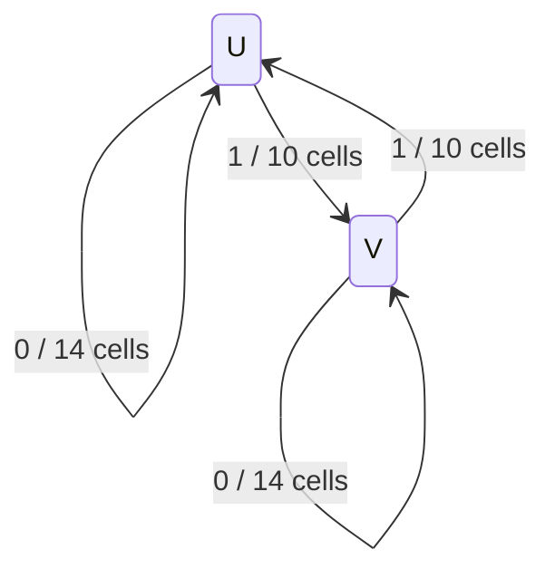

# The period12 return state and its odd temporal phase

GPT GC2829,10November2026. Owner-authorized manual instinct block, aiming for
about30minutes. Both recurring schedules PAUSED; no Local build/post or Cloud
atlas task is taken over. New hand statements remain PROOF-SKETCH pending a
different worker's carrying read; finite outputs keep their own status.

**Outcome:** the small return machine retains a branch bit and a separate
odd3 temporal phase. It gives a state-preserving ordinary-period formula and
three freely joining34-cell tiles. Linear parity is insufficient; a quadratic
phase recognizer exists on the certified components but fails without their
viability guard. No general exclusion of dyadic branching is proved. All four
fixed mathematical checks pass; the separately stopped regex-search overrun
is disclosed in the accounting below.

## Question and known inputs

**Pull:** why does period12 admit spatial branching while the dyadic cores
checked so far are unions of cycles and walls? Separate this whole-line
question from entry behind a black edge. Success here means an exact small
return/phase mechanism or a precise failed conjecture, not a prize proof.

**Record searched:** original LN12/individual skeptic repairs; GC2828 carrying
read; G157/G158 and genealogy25/29; current actual kit03a19bf6240b63c6d15894c5f7552f3a6091d937
lean/equivalents/catalogues, in particular MovingWaves/MovingStrip/RingOrbits,
RightPeriods and PeriodicPoints. Complete known refresh16:51:33portal/38PRs,
no changes. Relevant open/closed kit PR search identifies closed PR232,
R30-20261108-9933fc, to be read with its exact source and linked material.

The kit already proves `low_period_linear_words`, `free_binary_period_twelve`,
`exact_period_twelve`, `exponential_marked_rings` and `exponential_words_twelve`.
Its two34-cell profile tiles and four-seam kernel certificate are prior art.
Their new explanatory use is the target, not rebuilding that theorem.
G157 already excludes creating odd temporal factors in the rooted edge-history
tree. The old LN12 report gives a30-state component and temporal action; its
precise return paths/phase recognition are what this block inspects.

## First fixed pilot freeze

Prediction before execution: the graph reached from the literal kit tile
entry pair and its12 temporal rotations stays below4096nodes; its root cyclic
component has30states/32edges, two branching states, first branch returns of
length14(self) and10(other). Temporal shift permutes six such components and
its sixth power exchanges their branch states. These are predictions, not
assumptions in the extractor. A different answer changes the next question.

Counterfactual: a mixed temporal-phase seam or dyadic-compatible return that
passes the literal equations would break the proposed fixed-phase picture.
Unexpected test: independently shift each adjacent tile by0/4/8 temporal
ticks, predicting that all unequal-phase seams fail. All12x12phase pairs
and all four spatial-bit pairs are checked, not just a random sample.

Positive controls: reproduce the1632same-phase local tile equations and
check each generated integration edge at all12ticks including wrap. Compare
the original14/20loop construction and quoted component sizes. Independent
algebra controls: all64pairs of three-bit triples under OR in F2/F4
coordinates, and all4096words for the4-periodic/odd-sector projector and
its integration inverse. No full2^24pair census, no higher period or graph
cap retry. A cap/monitor/pressure stop is evidence and redirects to hand work.

Sources: [extractor](../tests/probes/swarm/sw02/carry/gpt_period12_return.py),
[hashed plan](../tests/probes/swarm/sw02/carry/gpt_period12_plan.json).
Actual MovingWaves source SHA256
`0ab24513cc18e4225e2b17bd0358a2776d387b8b21a32ff0bdb6945142bc72f3`.
Extractor pins it before reading literal profiles.

One Intel stage, one CPU worker/nice10, no solver/GPU/Lean/Wolfram:
25aggregateCPU stop within30CPU stage ceiling,90wall,768MiB treeRSS,
max4processes,16MiB/file,128MiBstage. Existing serial supervisor includes
outer-monitor CPU and thermal checks; run_capped tree tracking,
4096MiB launch/1024MiB running free floors and4096MiB swap-growth stop.
Sources/plan and these predictions published before execution.

No output or result was asserted in the pre-run freeze.

## First pilot outcome and second fixed validation freeze

The first pilot COMPLETED, no stop. The generated graph has552nodes/576edges;
exactly six cyclic components of30nodes/32edges. At root component C the two
branch states are U=(1323,2868), V=(2772,3372). Their first branch returns are
U->U and V->V of length14; U->V and V->U of length10. Temporal rotation has
component orbit6, its sixth power swaps U/V, and every C pair has least
temporal period12. All64OR-triple and4096projector controls pass.
All unequal-phase seams fail, including the unexpected0/4/8mixes; same-phase
seams pass for both tile bits. This is COMPUTED, not an all-dyadic theorem.

This suggests an exact return description: a binary event0 takes14cells and
keeps the branch, event1 takes10cells and switches it. For a primitive periodic
event word of length m with r ones, put L=14m-4r. Prediction:

* if r is even, the least spatial period is L and the ordinary Rule30 time
  period is lcm(12,L);
* if r is odd, the least spatial period is2L and ordinary time period is
  12L/gcd(2L,L+6).

The first controls would be84 for one self loop,30 for one cross repeated,
204 for self/cross/cross (L=34), and48 for self/self/cross/cross (L=48).
These match the old reported ring periods, but no general formula is inferred
from four matches. The second pilot tests every primitive binary event word
of lengths1..6 by an independent packed ordinary-rule evolution, with literal
least spatial/time periods. Counterfactual: any mismatch refuses the formula
and retains the exact word; no length7 retry.

An independent C++ checker enumerates all4096candidate integrations per
generated pair, checks exact closure/strong connectivity, six-component
temporal action and existential peeling of the exterior. Prediction: the
infinite-continuation kernel is exactly those180vertices, with no cross-phase
edge. A single corrupted edge must be rejected. This tests the generated
certificate without its prefix-XOR/SCC implementation.

Additional discriminant: find all linear F2 parities constant within each of
the six components. Prediction: they do not distinguish the odd3 phase;
a nonconstant three-phase label would be an unexpected simpler invariant.
This is a fixed24-variable rank calculation, not a polynomial-degree search.

Sources: [scalar C++ checker](../tests/probes/swarm/sw02/carry/gpt_period12_certificate.cpp),
[period-law controls](../tests/probes/swarm/sw02/carry/gpt_period12_law.py),
[second frozen plan](../tests/probes/swarm/sw02/carry/gpt_period12_law_plan.json).
Input graph and normalized text/mutant are hash-pinned in the plan.
Second stage aggregate stop55CPU,180wall,768MiBtreeRSS,max6processes,
16MiB/file,127MiBoutput. Together with first stage's actual<1MiB, this keeps
the block's128MiB data budget; combined nominal aggregate stops25+55=80CPU
remain below120. Same launch/running/swap/thermal/tree guards, sequential only.
No failure or resource cap is being retried or enlarged.

## What the small graph actually explains

The second pilot COMPLETED. An independent scalar C++ checker verifies all552
nodes/576edges by testing every possible12-bit integral, rather than using
the extractor's prefix-XOR formula. Existential pruning leaves exactly the180
vertices of the six30-state components after6rounds; no infinite continuation
from the generated family can leave its component. A corrupted edge is
rejected. All106primitive event words of lengths1..6 pass both the literal
least-spatial-period check and the predicted ordinary-time period.

The common-parity test has rank24: **no nonzero F2-linear parity of the two
complete12-tick profiles is constant on each of the six components**. Adding
a constant gives only the globally constant affine parities. This is a
finite24-variable statement, not a ban on nonlinear phase labels or on
observations involving more spatial cells. It sharpens the initial pull:
the relevant object is a retained phase/return state, rather than one
ordinary parity bit of the observed pair.

### A two-state return machine

Use increasing depth, i.e. move left along spatial sites. The certified cyclic
component has exactly two vertices with two continuing children:

* U=(1323,2868);
* V=(2772,3372).

Every other continuing vertex has one child. The next branch is reached by
exactly the following four paths:

The paths have shared final segments; they are not four disjoint corridors.
For example the30-state count is not14+14+10+10 minus two endpoints. The
return coding records a path between successive branches and so preserves
this overlap, its position, and the incoming branch. Collapsing U and V would
lose the state needed to decide whether a finite spatial return has closed.

**Hand consequence, PROOF-SKETCH on the finite certificate.** Every bi-infinite
binary event sequence beta has a realization after choosing one branch at
one marked boundary. Event0 costs14cells and preserves that branch; event1
costs10cells and toggles it. Conversely every bi-infinite path in this component
hits branch vertices infinitely in both directions and has this description.
Otherwise a cycle avoiding all branches would be a separate closed component,
contrary to the checked strong connectivity and unique outgoing edge there.
The bounded return paths give the inverse description.

This explains the known component entropy without a floating eigensolver.
The weighted two-branch return matrix is

`[[z^14,z^10],[z^10,z^14]]`.

Its positive growth root satisfies rho^-14+rho^-10=1. Squaring the equivalent
1-z^14=z^10 gives the recorded polynomial
rho^28-2rho^14-rho^8+1=0. This is **known, rederived here** from the return
paths. It is not a new full-core classification or entropy theorem for dyadic
periods.

### A three-valued temporal phase, and a separate branch bit

Let R rotate every12-bit temporal profile by one tick. On components,
R acts as a6-cycle C0,C1,...,C5. On a fixed component R^6 is an involution J
with no fixed pair; in particular J(U)=V and J(V)=U. Applying J to a first
return preserves the event0/1 and exchanges the endpoint branch labels.
This follows from the explicit paths and temporal rotation commuting with
the local equation.

For a whole-line configuration whose profiles lie in one of these components,
define kappa=i modulo3 when its pair belongs to Ci. The finite certificate's
pruning ensures that all continuing neighboring pairs have the same i.
Hence, for the spatial shift sigma and moving time tau=sigma F,

`kappa(sigma x)=kappa(x)`, and `kappa(tau x)=kappa(x)+1 mod3`.

This is a finite **nonlinear** phase recognizer on this specific family.
It reads two complete temporal profiles, not two cells of one row. On the
period12 family those profiles are determined by a finite initial-row window,
so the label is continuous there. The rank24 result says that a linear parity
of this particular24-bit observation cannot replace it.

Any equality tau^n x=sigma^s x in this family therefore needs3|n; the full
six-component label strengthens this to6|n. No dyadic time return, even
with a compensating spatial translation, can occur **inside this family**.
That conclusion is about the certified components, not about all Rule30
configurations of power-of-two temporal period.

The unexpected seam test is now explained: independently choosing temporal
phases0/4/8 on adjacent tiles attempts to change kappa across their junction.
All24 unequal-phase choices for the four spatial-bit pairs break both seam
column equations. The48same-phase choices among the full576tests pass;
all528unequal-phase choices fail. The binary spatial symbol is free, whereas
the temporal phase is shared by the whole connected path.

Kappa alone explains the selected0/4/8mixes, not all528failures. Shifts3/6/9
keep kappa; the full component and entry-branch alignment still obstruct
their seams (a6-tick shift swaps the branch). Retaining only the odd3label
would therefore discard part of the boundary condition we have just measured.

### Exact ordinary Rule30 periods from the return state

This is a new hand derivation to be carried by another worker. It concerns
only periodic paths in this certified component (and its temporal images).

Let beta be a primitive periodic event word, m its length and r its number
of1events. Put L=14m-4r. A spatial period maps a branch vertex to a branch
vertex, hence shifts beta by a multiple of m events. Each such shift changes
the branch by r modulo2. Thus the **least spatial period** is L if r is even,
and2L if r is odd. This uses branch recognizability; it is not a word count.

Moving time tau^6 acts as J: it keeps the event sequence and flips the branch.
If r is even, J is not a spatial shift of this path. Any such shift would
move beta by a multiple of m while preserving the branch, a contradiction.
For ordinary time F=sigma^-1 tau to return,6|n first; writing n=6q, q must
then be even, and the spatial shift n must be divisible by L. Therefore

`period_F = lcm(12,L)` when r is even.

If r is odd, a displacement of L cells implements J; displacements plus/minus L
are identical modulo the spatial period2L. Thus F^(6q) returns precisely when
`(L+6)q=0 mod2L`. Its least period is

`period_F = 12L / gcd(2L,L+6)` when r is odd.

All106primitive words of lengths1..6 were checked against independent
ordinary-row evolution; none returned before its predicted period. The four
old examples are now consequences:

|Event word|L|Least spatial period|Ordinary F period|
|---|---:|---:|---:|
|0|14|14|84|
|1|10|20|30|
|011|34|34|204|
|0011|48|48|48|

These are the two14-cycles, the cross/cross20-cycle, and their composites up
to marked origin/time phase. The original A/B values84,30,204,48 are not new
measurements; the state-preserving formula is the explanatory step.

As a corollary, the minimum ordinary F period within these six components is30.
For m>=3, L>=10m>=30 and the displayed period is at least L. The only smaller
primitive event lengths give84(m=1,r=0),30(m=1,r=1) and48(m=2,r=1).
An F-periodic configuration here must be spatially periodic, since tau^12=id
implies sigma^(12n)x=x whenever F^n x=x. Thus no aperiodic event sequence is
an unexamined exception to this minimum. This is not the global minimum
ordinary period for Rule30 (white, for instance, is fixed).

### Why34 is natural; a third same-length code word

**PROOF-SKETCH, no further computation launched.** A return to U requires an
even number of cross events. Before length34 the only nonempty return words
are0(length14),11(length20), and00(length28), each unique at its own length.
At length34 there are exactly three:

`011`, `101`, `110`.

They are U-self/cross/cross, U-cross/V-self/cross, and cross/cross/U-self.
All start and end at the same actual pair U, so arbitrary concatenations
of all three give valid period12 profile fields. Distinct profile paths give
distinct34-bit initial tiles: otherwise replace one tile in a fixed common
two-sided continuation. The entire initial row would be unchanged but its
future profile field would differ, contradicting deterministic evolution.
Consequently two initial-cell positions suffice to decode the three symbols.

Thus the existing two-symbol34-cell construction has an explicit three-symbol
return-code extension, with spatial entropy at least log2(3)/34 bits per cell.
This is weaker than the known full component entropy, and is a corollary of
the same known graph mechanism, not a new positive-entropy discovery. At this
hand-deduction stage the literal third tile had not been exported; the fixed
check below now supplies it. No Lean module was built. The exact minimum34
here is for multiple equal-length return paths at U, not every possible
coding/attachment in the whole automaton. It explains why concatenating a
14return and20return is a convenient equal-roof code.

### Third fixed check, frozen before export

The third-word deduction warrants one literal finite artifact check, not a
larger search: concatenate the already saved return paths011/101/110, reverse
their leftward profiles, and check all9seams/34sites/12ticks,3672equations.
Prediction: all pass; the original kit two tiles are two of these three;
three distinct34-bit initial words admit a two-position decoder. A one-bit
temporal-profile mutation must fail. Counterfactual: any bad seam/duplicate
word refuses the ternary code, with no longer tile search.

**Control audit:** the first extractor checked seams and reused the kit's
known interior certificate; it did not independently re-execute all1632local
equations, despite the broader positive-control wording in the initial plan.
This final tiny check completes that intended control explicitly, using the
rule-number truth table. No claim of an earlier full1632replay is made.

Sources: [literal three-tile check](../tests/probes/swarm/sw02/carry/gpt_period12_three_tiles.py)
and [third fixed plan](../tests/probes/swarm/sw02/carry/gpt_period12_three_plan.json).
10aggregateCPU stop,30wall,768MiBtreeRSS,max4processes,16MiB/file,
126MiBoutput (the completed first two directories total<2MiB), same free/swap/
thermal/tree guards. Combined *mathematical check* stop budgets25+55+10=90CPU
remain below120. The unrelated slow record search described below is charged
separately and is not hidden in this figure. No failed research job is retried.

## The algebraic separation and its limits

Write S for temporal shift and work over F2 on12-periodic temporal words.
The cyclic module decomposes because

`S^12-1=(S+1)^4 (S^2+S+1)^4`.

The projector E=1+S^4+S^8 has image the4-periodic words; Q=1+E=S^4+S^8
is the complementary odd-factor sector. Direct identities are E^2=E,
Q^2=Q and EQ=0. On Q's image, temporal difference Delta=1+S is invertible,
with inverse S^4+S^5+S^6+S^7. This follows from

`(1+S)(S^4+S^5+S^6+S^7)=S^4+S^8=Q`.

On E's image Delta is nilpotent of index4. For purely dyadic cap2^k the whole
cyclic module is the nilpotent sector, since S^(2^k)-1=(S+1)^(2^k).
These are standard characteristic-two/CRT facts, not Rule30-specific results.

The nonlinear gate couples the sectors. At each of the four time residues
modulo4, encode the three bits x0,x1,x2 at offsets0/4/8 as

`d=x0+x1+x2 in F2`, `z=x0+omega*x1+omega^2*x2 in F4`,

where omega^2+omega+1=0. They invert as
x_j=d+Tr(omega^(-j)z). For two triples(d,z),(e,w), OR has coordinates

`(d+e+de+Tr(z*w^2), (1+e)z+(1+d)w+(zw)^2)`.

Expanding the traces proves this; all64triple pairs passed an independent
literal truth-table check. The odd sector cannot simply be discarded as
another linear observable: it interacts quadratically with itself and the
dyadic part.

**The edge exclusion is already known (G157/Jen–Rowland/Nersissian).**
If the two driving profiles are4-periodic, the next profile w has
Delta w4-periodic. Hence w(t+4)+w(t) is a constant epsilon. Repeating this
three times in a12-periodic word gives0=3epsilon=epsilon, so w is4-periodic.
The odd factor cannot be generated from a4-periodic pair. More generally,
binary-tree automorphisms have only power-of-two cycles on each finite level;
a finite orbit of period12 in the rooted2-adic system is already4-periodic.
The whole-line period12 phase must therefore come from its infinite spatial
history, rather than a finite black-edge entrance. This is the prior-art
domain distinction made concrete, not a new light-speed recurrence proof.

**A useful countercontrol to overgeneralization:** on the very same
positive-entropy family, the time map tau^3 has exact order4. It remains a
left-permutative cellular automaton, now a three-tick/radius6 rule. Thus
dyadic time order plus left-permutativity alone cannot forbid spatial
branching. The one-tick elementary OR law must enter any proposed theorem
about Rule30's dyadic components. Return topology without the temporal
generator is insufficient.

What remains open is sharper than the initial vague parity question: does
the **one-tick** Rule30 profile graph have a branching component at a dyadic
period beyond16? This block neither computes that graph nor supplies its
exclusion. Its exact phase/return code and failed linear-parity route give a
test object and a countercontrol for a proposed proof.

## Following the warmer question: a quadratic phase recognizer?

The three-tile check passes3672equations; original kit1632control now also
passes in full. Mutation breaks6equations. Initial words are distinct, decoded
by offsets20,23 as01,00,10. The original binary tiles are words011 and110;
101 is the third. This is a finite artifact, not a new Lean submission.

The rank24 result redirects from a linear parity to a **covariant quadratic**
observable on the same fixed pair space. Freeze one final tiny question:
for every orbit of a degree1/2 monomial under temporal rotation R, use the
F4 orbit sum B(v)=sum_t omega^(-t)m(R^t v), retaining orbits of length divisible
by3. There are26such orbit sums. They satisfy B(Rv)=omega B(v) as polynomial
identities. Does a linear combination over F4 equal1 on C0, and hence
omega^i on Ci? Prediction: yes; tentative stronger prediction, at most4orbit
sums suffice. Failure settles this basis only; no degree3 extension today.

Countercontrols: evaluate the result on all180component vertices and256fixed
arbitrary pair rotations. Then test256fixed random pairs' legal integration
edges: prediction, it is **not** a global invariant on that unrestricted
population. Also report behavior on all576generated edges, without inferring
infinite-continuation guards from a passing sample. If no quadratic solution
exists, preserve the inconsistent system instead. This is a30x26F4system
on the existing certificate, not another core/period census.

[Fixed phase-question source](../tests/probes/swarm/sw02/carry/gpt_period12_quadratic_phase.py)
and [plan](../tests/probes/swarm/sw02/carry/gpt_period12_quadratic_plan.json):
10aggregateCPU stop,30wall,768MiBtreeRSS,max4processes,16MiB/file,125MiBoutput
with previous three directories<3MiB; same free/swap/thermal/tree guards.
Total nominal mathematical check stops25+55+10+10=100CPU remain below120.
The stopped record-search CPU is separately disclosed; it is not a successful
capped run or a reason to enlarge this final test. Sources/plan published first.

## Final outcomes, guard and carrying questions

The quadratic prediction is partly confirmed and partly refuted. The26-column
F4 system has rank15 and is consistent. A13-orbit-sum solution H equals1
on C0 and omega^i on Ci; its temporal covariance H(Rv)=omega H(v) is built
into the monomial orbits and passes all180vertices plus256arbitrary pair
rotation controls. The stronger prediction of at most4orbit sums is
**REFUTED within this fixed basis** by the complete1/2/3/4term search. No claim
of a minimum beyond4 or of failure in other bases is made.

The particular H is **not a global spatial invariant**:198of258legal edges
sampled from the fixed arbitrary-pair control fail, including

`(1653,73) -> (1110,1653)`, with H changing from omega^2 to omega.

It also fails on216of576edges of the generated graph. All192edges inside
the six cyclic components preserve it, as their phase labels require.
Thus even a successful quadratic classifier must retain the infinite-path
guard. The explicit coefficients/basis and all controls are in the evidence;
there is no reason to promote this dense finite recognizer to a universal law.

A small finite guard is available **in this generated graph only**. The
existential peel stabilizes on round6, including the unchanged final pass,
so every vertex outside the180-state kernel has at most4further edges before
termination. An allowed path of6edges therefore has its first edge inside
one component and preserves H there. These are further *spatial profile
columns*, not6physical time ticks. No uniform-in-period statement follows.

The explicit three34-bit initial words, in increasing spatial-site order,
are:

|Return word|Initial tile|Bits at offsets20,23|
|---|---|---|
|011|`0001111110000100011100011111100001`|01|
|101|`0001111110000100011100000001000111`|00|
|110|`0001111110000100011111100001000111`|10|

The old kit zero/one tiles are rows011/110. All9seams pass3672truth-table
equations, the old full1632control passes, and a profile-bit mutation breaks6
equations. The three uniform tiles each have least moving period12; arbitrary
bi-infinite strings of the three inherit that period from the checked pair
states. Two-cell decoding makes the fixed34-site code injective. This is a
concrete finite packet and a hand generalization awaiting a main-worker read,
not a posted/kernel-verified ternary theorem.

**For Cloud when available, two carrying questions only:**

1. Carry the return coding/branch recognizability and the even/odd-r derivation
   of the ordinary-time period. In particular check the necessary6|n component
   action and the odd-r condition2L|(L+6)q for n=6q. The106literal controls
   are evidence, not a replacement for the all-word proof.
2. Carry the arbitrary ternary concatenation and static-row injectivity step,
   with the shortest34equal-length-return claim restricted to U. The3672
   local equations and decoder are exact finite inputs, independently checkable.

Cloud's atlas17/recharge ownership is preserved. This is a passive carrying
pointer, no duplicate core search or Local build assignment. Future dyadic
work must retain the one-tick elementary OR law: tau^3 is an explicit
countercontrol to arguments from dyadic order/left-permutativity alone.

## Accounting and provenance

Four sources/plans were committed and pushed before their runs:
e6769272 (first extraction),9bb83e1c (independent checker/period law),
a71e5c9b (third tile/full original control),c2e0d459 (quadratic question).
All four COMPLETED with no capped-job stop. Aggregate CPU including outer
monitors:0.370395+2.375608+0.333015+0.404786 = **3.483804seconds**.
The stages took0.55/2.77/0.55/0.55wall seconds. Only the second lasted long
enough to produce running tree samples: sampled peak105200KiB, at most4
processes, minimum free5667MiB, zero swap growth. The faster stages have
launch headroom/child wait4 RSS receipts, not a falsely reported zero peak.
All thermal checks pass. No Intel job, GPU, solver, Lean or Wolfram remains.

**Separate search failure:** an additional `record_find.py` search used a
broad backtracking regex with several `.*` alternatives. It became CPU-bound
before producing output. At inspection its process CPU was247.81seconds;
GPT interrupted it with SIGINT (exit130) and confirmed that it had exited.
That is a **lower bound**, not exact final CPU, and is outside the successful
capped mathematical-stage total above. This unintended unbudgeted search
was a workflow error; its traceback/stop note are retained. Subsequent prior-art
lookups use narrow literal `rg` on named mathematical sources. No broad search
retry, hidden cap enlargement or pressure-triggered job retry occurred.

Current kit03a19bf6240b63c6d15894c5f7552f3a6091d937 and complete index
16:51:38.621740Z (portal16:51:33Z,38PRs,zero changes). Closed PR232's actual
head cf562da98b9bf8b9f4f4605f6a56fa06821e32bd MovingWaves source was fetched
and is byte-identical to current main, SHA2560ab24513...bc72f3. Full body,
conversation, review-summary and inline channels read. Feedback concerned
README escaping and provenance text; no mathematical objection or linked
external proof archive. Its kernel lower-period certificates are cited as
existing results, not rebuilt or independently re-certified here.
Primary Nersissian2609.25077v1 §4.1/Theorems10–12 re-read for the known
reset/integration mechanism. No literature-priority claim is made for the
return-code or elementary CRT/Perron-Frobenius reasoning.

The block began16:50:55UTC and ends after the requested approximately30minutes.
Both existing GPT automations remain PAUSED. Subsequent work is the named
independent carry and then a separately chosen one-tick-specific question;
no new period census is authorized by these completed pilots.

Immutable evidence: `cited/gc2830-period12-phase-return-20261110.tar.gz`,118881bytes,
SHA256 `a1622e88a6395f300ab2973c6fc40a80a4c5e857fcd7501181299371a0e46463`,81files;
verified TLS/raw-body upload and byte-exact readback. Frozen sources/plans,
full generated graph/certificate/mutant, four runs and receipts, phase/period/
three-tile artifacts, prior-art pins and separately disclosed search stop.
The archived review precedes this receipt and the final clarification that
kappa alone does not explain3/6/9-tick seam failures; the final git report
contains that additional scope guard. Data stays outside git.
